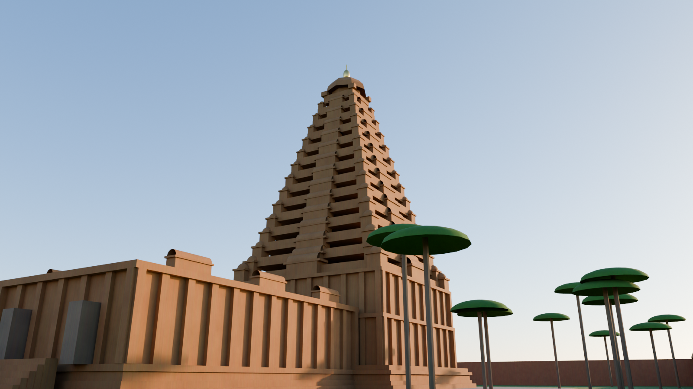

# Hobby Project 1: Chola Kingdom

Cinematic 3D recreations of four Chola-era sites, set in the world of *Ponniyin Selvan*: historically grounded models, game-style visualisation, and animated cinematic shots.



## The four sites

| # | Site | Built | Role in the story / visual |
|---|------|-------|-----------------------------|
| 01 | **Veeranam Lake** (Veeranarayanapuram eri) | c. 10th C, Parantaka I | The opening of *Ponniyin Selvan*: Vandiyathevan riding along the bund during Aadi Perukku. Water, swings, festival boats. |
| 02 | **Gangaikonda Cholapuram**, Brihadisvara | c. 1035 CE, Rajendra I | Imperial capital after the Ganga campaign. Aerial and drone shots. |
| 03 | **Airavatesvara, Darasuram** | 12th C, Rajaraja II | Chariot-wheel mandapa, elephant balustrades, yali pillars. Close-up and macro shots. |
| 04 | **Brihadeeswarar, Thanjavur** | c. 1010 CE, Rajaraja I | Arulmozhivarman's (Ponniyin Selvan's) own temple. Hero shots and finale. |

Reference photos: [`references/sites`](references/sites). Target look (godrays, overgrowth, volumetric haze, foliage): [`references/style`](references/style).

## Pipeline

```
1 Blockout  ->  2 Detail kit  ->  3 Materials  ->  4 Set dressing  ->  5 Lighting/FX  ->  6 Shots & animation
 (done: 04)     (kuta, shala,     (granite, brick,   (palms, crowds,     (volumetrics,     (camera paths,
                pillars, yali)    gold, water)       lamps, boats)       golden hour, rain) Eevee/Cycles)
```

Everything is generated by Python scripts in [`blender/scripts`](blender/scripts), so you can rebuild, tweak and version the models. Blender's AI/MCP connection (as in the reference reel) can drive the same scripts live.

## Quick start

1. Install [Blender 4.2+](https://www.blender.org/download/) (tested on 5.0).
2. Render the Thanjavur blockout:
   ```bash
   blender -b -P blender/scripts/thanjavur_blockout.py -- --render renders/thanjavur --samples 64
   ```
   Or open Blender, go to **Scripting**, open the file and click **Run Script** to explore it in the viewport.
3. Add `--save thanjavur.blend` to keep the scene.

## Status

- [x] Site 04 Thanjavur: procedural blockout (66.7 m vimana with 13 talas, mandapas, Nandi mandapa, cloister, 2 gopurams), golden-hour sky, 2 cameras
- [ ] Site 02 Gangaikonda Cholapuram blockout
- [ ] Site 03 Darasuram blockout
- [ ] Site 01 Veeranam lake environment (water, bund, swing tree)
- [ ] Detail kit, materials, foliage, volumetrics
- [ ] Cinematic shot list and animation

See [`docs/project-brief.md`](docs/project-brief.md) for the full plan and shot list.
